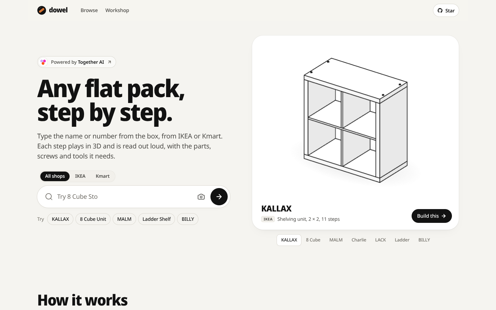
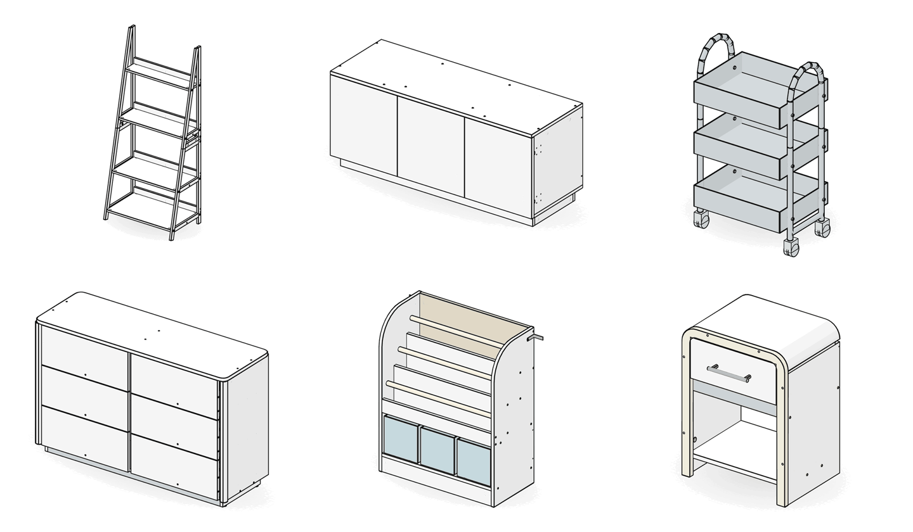
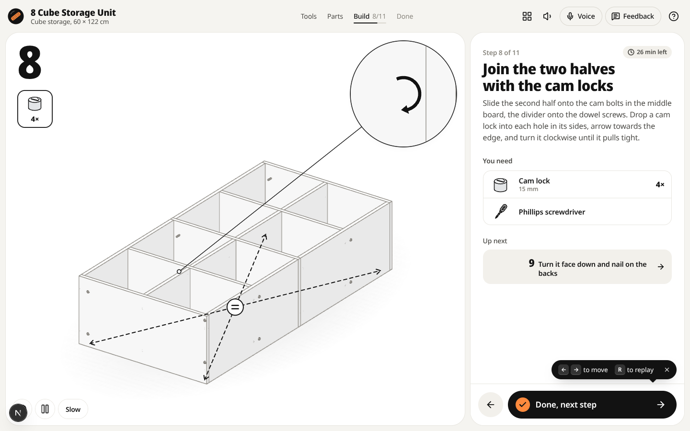
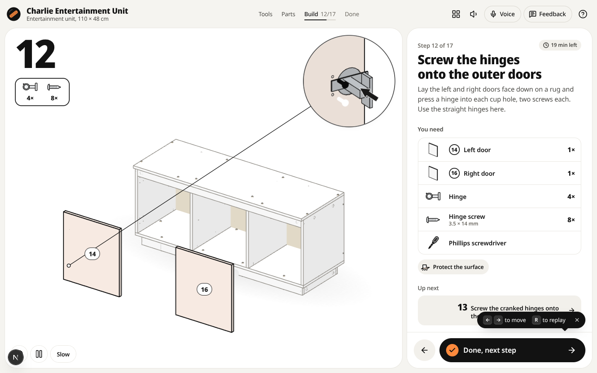

<p align="center"></p>

<h1 align="center">Dowel</h1>

<p align="center">Any flat pack, step by step. Type the name or number on the box, from <b>IKEA</b> or <b>Kmart</b>, and follow every assembly step in 3D, drawn like the paper manual and read out loud.</p>

Dowel is a multi-brand fork of [Bygga](https://github.com/Nutlope/bygga) (MIT), the open-source IKEA guide engine by Hassan El Mghari and Youssef El Mghari. It keeps Bygga's engine, generator, IKEA catalog and voice, and adds a brand layer so any shop's flat packs can be drawn the same way. Kmart Australia is the first shop added. A full teardown of Bygga is in [`docs/bygga-teardown`](docs/bygga-teardown/README.md).

## What's in it

| | IKEA | Kmart |
| --- | --- | --- |
| Products / guides | 1,223 / 2,225 | 111 / 111 |
| Find it by | name (KALLAX), article number (802.758.87), ikea.com link | name (8 Cube Storage Unit), keycode (42633297), kmart.com.au link |
| Guides that follow the shop's own manual | 2,139 (from Bygga) | 16, written from Kmart's PDFs: cube units, ladder shelf, Wharf, Charlie, Miles, Stevie, Linear, kids storage, trolley |
| Voice | 1,497 clips (Together) | every Kmart line, plus the top IKEA guides' missing lines, recorded locally with the same Kokoro voice |

- **One search for every shop.** "All shops / IKEA / Kmart" switch, brand tags on every result, and brand words in the query work too: `kmart bookcase`, `IKEA KALLAX`, `my billy` and `the kallax` all land right (Bygga's search read "IKEA" or "my" as the product name).
- **Kmart guides from Kmart's manuals.** The 8 Cube Storage Unit is built the way its manual builds it (two halves of four cubes joined on the middle board with cam locks, backs nailed on face down) with Kmart's own part numbers 1 to 9 and exactly the hardware in the bag: 20 screws, 20 dowels, 10 dowel screws, 4 cam bolts and locks, 48 nails, 16 caps and the wall kit.
- **Brand-aware everything.** Covers show the shop and its number ("Keycode 42633297"), link to the right site for the manual, the help chat and FAQ know where to get missing parts, share cards and disclaimers name the right owner, and AI drafts for unlisted products ask about the right shop.
- **Fixes over Bygga.** Voice answers no longer sit in a shared CDN cache, shared scan links are ignored while the scanner is off, feedback strips terminal control characters, Motion animations honour reduced motion, missing-part rows say which part, the lightest grey passes contrast, and 60 IKEA guides that had no drawing now have one.

<p align="center"></p>

| Kmart 8 Cube Storage Unit, step 8 | Kmart Charlie Entertainment Unit, step 12 |
| --- | --- |
|  |  |

### Kmart guides from Kmart's manuals

Every one of these follows its own Kmart manual: the same steps in the same order, Kmart's own part numbers and letters, and the hardware counts printed on the manual's list.

| Product | Steps | Notes |
| --- | --- | --- |
| 8 Cube Storage Unit | 11 | two halves of four cubes joined on the middle board with cam locks; backs nailed face down |
| 4 Cube Storage Unit | 7 | dividers on dowel screws, sides, ends, backs, caps, wall bracket |
| 4 Tier Ladder Shelf | 6 | angled legs joined in pairs, rails on every shelf |
| Wharf 5 Tier Bookshelf | 5 | shelves bolted between two frames, feet, wall brackets |
| Wharf Student Desk | 5 | built upside down on the top: beam, leg frames, cross brace |
| Charlie 6 Drawer Chest | 22 | carcass on cam bolts, plinth, two backs, six drawers on runners |
| Charlie 2 Drawer Bedside Table | 16 | |
| Charlie Entertainment Unit | 17 | three doors on straight and cranked hinges |
| Charlie 2 Tier Shoe Cabinet | 8 | tilting trays |
| Miles 6 Drawer Chest | 24 | two-person steps where the manual marks them |
| Miles Entertainment Unit | 17 | curved end doors |
| Stevie 4 Drawer Chest | 17 | |
| Linear 1 Drawer Bedside Table | 24 | |
| Kids Bookcase with Storage | 20 | |
| Kids Storage Unit with 6 Tubs | 19 | |
| White 3 Tier Trolley | 6 | metal frame, braked castors on opposite corners |

Kmart's manuals sometimes disagree with themselves: a step's count box against its own drawing or the parts list (the 6 tub unit's step 5, the Stevie cam locks, the Miles clip screws). Each recipe picks the reading the drawings and totals support and says why in its comments. The other 95 Kmart products are drawn by the kind builders from their size and layout (drawer, door and tier counts from Kmart's listings), with their keycodes.

## Adding a shop

1. `src/lib/brands.ts`: the shop's name, owner, how it numbers products, where its manuals live, examples for the search box.
2. `src/data/<shop>.ts`: one row per product (name, line, kind, size in cm, keycodes per colour). `src/lib/catalog.ts` turns rows into guides with the kind builders, slugs `<shop>-<name>`.
3. `src/lib/plan/families/<shop>-<line>.ts`: recipes read from the shop's manuals, keyed `"<SHOP>:<LINE>"`, for the products that deserve an exact guide.
4. `npm run kmart:check` (or a copy for the new shop), `npm run families`, `npm run voice:local`, `node scripts/og/render.mjs --missing`.

## Running it

```bash
npm install
npm run dev
```

- Open http://localhost:3000, pick a shop, type `8 Cube` or `KALLAX`.
- Jump to a step: `/build/kmart-8-cube-storage-unit?step=8`; print: `/build/kmart-8-cube-storage-unit/print`.
- AI features (photo lookup, help chat, drafts, listening for "next") run on each visitor's own Together AI key, as in Bygga: `cp .env.example .env.local`, set `TOGETHER_API_KEY`, paste `dowel-dev-mock-key-000000` into the key box in development.
- Checks: `npm run kmart:check`, `npm run ikea:check`, `npm run voice:check`, `npm run lint && npm run build`.
- Voice for new lines without a key: `npm run voice:local -- --list todo.json`, `python3 scripts/voice/kokoro.py todo.json wavs/` (kokoro-onnx), `npm run voice:local -- --finish wavs/`.

## Notes

- Kmart's product pages turn away scripts, so there is no Kmart fetcher: the rows were researched from Kmart's public listings and manual portal (`kmart.com.au/instruction-manuals`, `wcsstore/Kmart/pdfs/<keycode>_Manual.pdf`). Manuals are read, never copied.
- Not affiliated with IKEA or Kmart. See [NOTICE](NOTICE). MIT, see [LICENSE](LICENSE).
