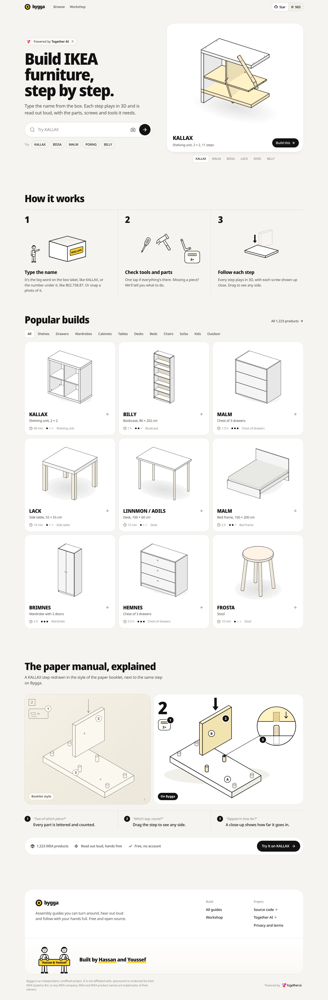
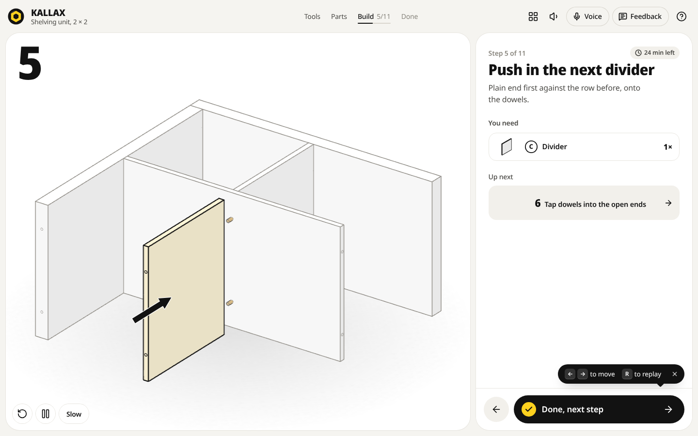
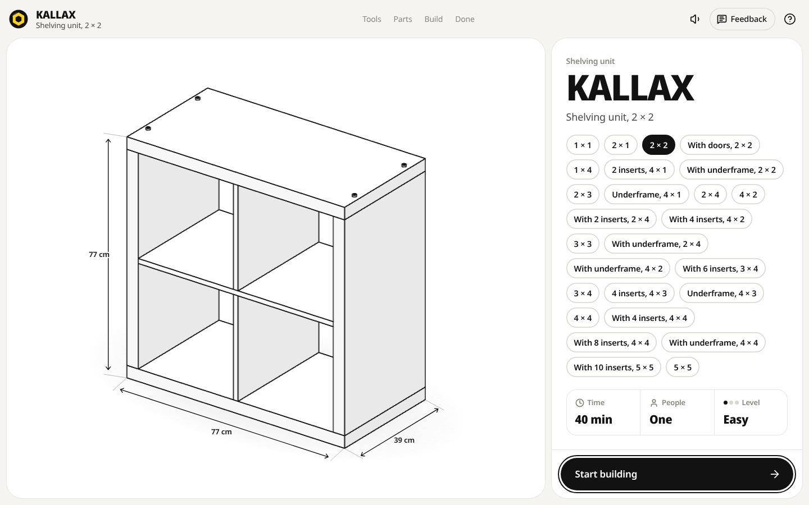
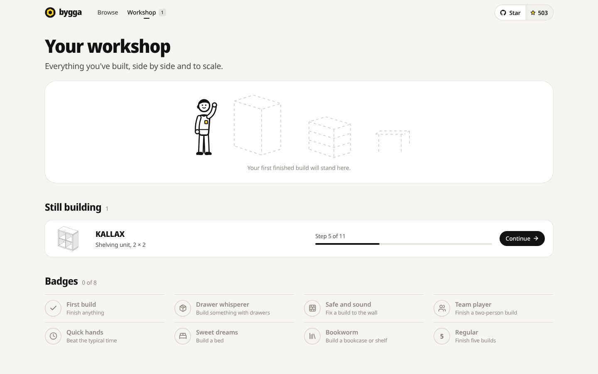
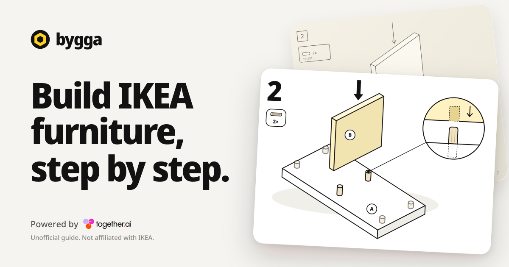
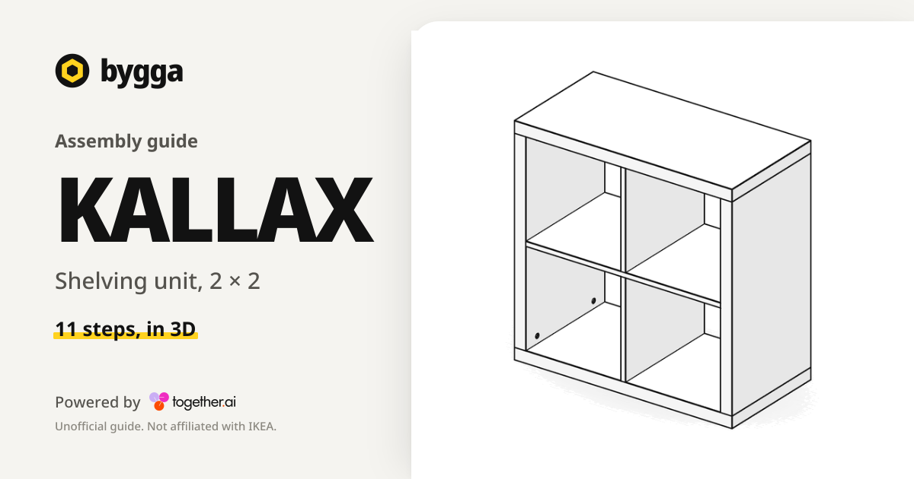

# Bygga (usebygga.com): complete teardown

Research date: 2 November 2026. Sources: the live site (HTTP probes, headless Chromium screenshots, bundle measurements), the full open-source repository `Nutlope/bygga` at commit `a02629a` (29 Oct 2026, 166 commits), GitHub search, and the public web (launch posts, press, issues).

Deep-dive appendices in this folder:

| File | Covers |
| --- | --- |
| [00-live-and-history.md](00-live-and-history.md) | Live deployment, headers, API surface, page weight, GitHub stats, git timeline |
| [01-engine-plan.md](01-engine-plan.md) | three.js line-art engine, parametric plan generator, 522 family recipes, full KALLAX walk-through |
| [02-catalog-search.md](02-catalog-search.md) | IKEA data pipeline, classification, article numbers, search algorithm, time estimates |
| [03-voice.md](03-voice.md) | Kokoro narration clips, Whisper "next" listening, echo handling, test harness |
| [04-ai-api-security.md](04-ai-api-security.md) | Together AI models and verbatim prompts, every API route, BYOK, security review |
| [05-frontend-ux.md](05-frontend-ux.md) | Routes, guide flow, Workshop, design tokens, PWA, accessibility |
| [06-story-web.md](06-story-web.md) | Launch, people, press, reception, competitors, pricing |



---

## 1. What it is

Bygga (Swedish for "to build") is a free, MIT-licensed, unofficial web app that turns an IKEA product name or article number into an animated 3D assembly guide drawn in the style of the paper booklet, read out loud, and controllable by saying "next".

- Tagline: "Build IKEA furniture, step by step. Type the name from the box. Each step plays in 3D and is read out loud, with the parts, screws and tools it needs."
- Coverage on the live site: **1,223 IKEA products, 2,225 guide pages** (one per size or variant; the sitemap lists exactly 2,225 `/build/<slug>` URLs), UK and US ranges, English only.
- Builders: **Youssef El Mghari** (product designer at Together AI, GitHub `Luffixos`, X `@YoussefUiUx`, 163 of 166 commits) and **Hassan El Mghari** (`@nutlope`, Director of Developer Experience at Together AI, 3 commits: analytics, repo move, link tracking). Footer: "Built by Hassan and Youssef".
- Sponsor: "Powered by Together AI". It is a Together AI developer-relations showcase in the line of Hassan's roomGPT, LlamaCoder and BlinkShot, but with a very different architecture (section 3).
- Built with Claude Code: **163 commits carry `Co-Authored-By: Claude Opus 5.5`**, the repo ignores `.claude/`, lint skips "agent worktrees", and work landed as parallel batches ("Merge third batch: wash-stands, kitchen and appliance cabinets...").
- Legal posture: "independent, unofficial project. It is not affiliated with, sponsored or endorsed by Inter IKEA Systems B.V." The `NOTICE` file says the MIT license grants no rights in IKEA's marks; IKEA's raw listings stay out of the current tree; no IKEA PDF, drawing or text is copied. Each cover's "Find the manual on ikea.com" link opens an ikea.com search for the name (`https://www.ikea.com/search/?q=KALLAX`); the exact PDF links that `measure.ts` collects never ship.

## 2. The story

| Date (2026) | What happened |
| --- | --- |
| 20 Oct | `Initial commit from Create Next App`. Package name `ikea-masta`. Repo under Youssef's account (`Luffixos/bygga`), preview on `bygga-eta.vercel.app`. |
| 21 Oct | One commit of 17,459 lines: parametric generator (shelves, drawers, tables, beds, cabinets, seats, sofas), **152 products**, the three.js line-art stage, tools/parts/steps/done flow, voice, and a **/scan** feature where Together AI reads photos of any paper manual. |
| 22 Oct | 527 narration clips recorded with **ElevenLabs Eleven v4 (Matilda)** via fal.ai; voice commands; headphone buttons. |
| 23 Oct | Voice moved to **Kokoro Heart on Together AI** (20× cheaper per character). Same day Hassan posts the teaser **"I'm never reading IKEA instructions again"**: 955K views, 11K likes, 7.5K bookmarks. |
| 24 Oct | First press (ITHardware.pl), written from the teaser alone. |
| 26 Oct | **108 commits in one day.** Scanner parked for v2. IKEA's public search API scraped (9,609 UK products). Article-number search, share cards, PWA, print view, offline. Then a run of "Draw X" commits, a new furniture kind every 2 to 5 minutes (office chairs, cots, bunk beds, kitchen cabinets, PAX corners, U-shaped sofas...). README counts climb through the day: 778, 829, 924, 973 products. Security hardening, design pass. |
| 27 Oct | 49 commits: MIT license, trademark NOTICE, privacy page, "Launch copy: no over-claims", offline voice, Whisper listening for every browser, **every AI feature moved onto the visitor's own Together key**, US range, final batch to 1,171 products / 2,180 sizes / 1,476 clips, domain `usebygga.com`. Repo moved to `Nutlope/bygga`. **Launch post 19:11 UTC: "Introducing Bygga! ... 100% free & open source."** 279K views, 3.5K likes. A third-party HN submission got 3 points. |
| 28 Oct | Issues land: "most nontrivial builds contain impossible instructions" (dowels passing through wood, a seat screwed to thin air), KYRRE stool with 3 legs, a missing IDANÄS. The team's own audit (`docs/manual-check-pilot.md`) finds **19 of 20 core guides differ from the real IKEA manual**. Answer: one commit of **1,635 files, +148,686 lines**: 461 per-family builders that follow each product's real manual. Feedback button added. |
| 29 Oct | "Fix build accuracy and animations": parts arrive along their dowels, screws end in wood, 2,139 of 2,166 guides follow their manuals. "Add 59 missing IKEA products" (1,223). Last commit to date. |
| 28 Oct to 2 Nov | European tech-blog coverage (DE: Caschy, LangweileDich, tchgdns, wihel; CZ: GeekLife; ES: Web Reactiva; EN: The Menon Lab, which calls it "vibe-coded"). No major English or Swedish outlet, no Product Hunt, no Together AI blog post, no IKEA statement. |

Repo on 2 Nov: **506 stars, 63 forks**, 4 open issues, 2 open outside PRs (search that skips a leading "IKEA"/"my", ELVARLI wardrobe guides), Cursor Bugbot reviewing PRs, and a derivative already announced: **Hackea** (hansipie/Hackea) for designing IKEA hacks on Bygga's engine.

The arc in one line: a viral teaser before the product existed, a 10-day agent-driven sprint to cover the whole catalog, accuracy criticism on day one after launch, and a 150k-line rebuild around the real manuals within 48 hours.

Closest prior art: Ryan Sael's "Flat Pack, Step by Step" (sael.net/flatpack, launched 19 to 21 Oct 2026, about 26 hand-built products, IKEA manual pages shown side by side). IKEA itself offers PDF manuals, YouTube videos and TaskRabbit, and no interactive 3D or voice assembly.

## 3. How it works (architecture)

```
                 BROWSER (does almost everything)                         SERVER (Next.js on Vercel)
 ┌───────────────────────────────────────────────────────────┐      ┌──────────────────────────────────┐
 │ catalog rows (src/data, ~2,200 specs)                     │      │ prerendered pages + share cards  │
 │   │ search.ts (names, article numbers, typos, type words) │      │                                  │
 │   ▼                                                       │      │ /api/guide    draft unknown items│──┐
 │ ProductSpec (cm) ──► buildPlan()  src/lib/plan            │      │ /api/identify photo of a label   │  │
 │        522 family recipes (one per IKEA name, follows     │      │ /api/help     "Stuck?" chat      │  │ Together AI
 │        the real manual) ► custom.ts geometry interpreter  │      │ /api/listen   WAV ► Whisper      │  ├► (visitor's
 │        or 7 generic kind builders  ► Plan (mm, steps)     │      │ /api/voice    text ► Kokoro mp3  │  │  own key)
 │   ▼                                                       │      │ /api/key      key check          │  │
 │ Stage (three.js): toon shader + screen-space ink lines,   │◄────►│ /api/feedback ► Upstash Redis    │──┘
 │   ortho camera, step animation, close-up callout          │ same │ /api/scan (parked)               │
 │ GuideApp: cover ► tools ► parts ► steps ► done            │origin│                                  │
 │ voice: 1,497 static Kokoro clips; mic ► AudioWorklet ►    │ only └──────────────────────────────────┘
 │   energy gate ► WAV pieces ► /api/listen ► hearIntent     │
 │ localStorage: progress, workshop, key; service worker     │
 └───────────────────────────────────────────────────────────┘
```

The core design decision: **the AI is not in the loop at view time.** Every catalog guide is a deterministic plan computed in the browser from a few numbers. No 3D model files, no LLM call, no server round trip. AI appears only at the edges: drafting a spec for an unlisted product, reading a box-label photo, a help chat, listening for "next", and live narration for lines that have no recorded clip. All of it runs on the visitor's own Together key; the site pays nothing per user.

### 3.1 Data: from IKEA's listings to catalog rows

Full detail: [02-catalog-search.md](02-catalog-search.md).

- **Fetch** (`scripts/ikea/fetch.ts`): IKEA's listing API `https://sik.search.blue.cdtapps.com/{gb|us}/en/product-list-page/more-products?category=<key>&start=&end=`, in windows of 1,000, for every category key scraped from `ikea.com/gb/en/cat/products-products/`. US sitemaps `prod-en-US_1..8.xml` add US-only names. One request at a time, 600 ms apart, three retries, everything cached in `scripts/ikea/cache/`. `facts.json` keeps only name, type, size text, article numbers, a combination flag and category keys (9,609 UK products).
- **Measure** (`measure.ts`): reads each product page `ikea.com/{market}/en/p/-<item>/` for seat height, armrest height, room under the frame, and the assembly-instruction PDF links (500 ms apart).
- **Classify** (`classify.ts`, 1,297 lines): about 200 regex rules over the lower-cased IKEA type, giving **74 kinds** mapped onto 7 archetypes (shelf, drawers, table, bed, cabinet, seat, sofa) with parameters; sizes parsed from cm, inches with fractions, and UK/US bed names. About 85 skip reasons (lamps, textiles, combinations it can't split); `ADDED` force-includes 59 products by article number; `FIXES` (98) and `SAME` (18) make hand corrections; 359 rows are US-only.
- **Build** (`build.ts`): merges colour variants, lets the 27 hand-checked entries in `catalog.ts` win, and locks every slug forever in `slugs.json`. Output: `src/data/ikea-rows.ts`, `ikea-items.ts` (7,020 article numbers across 2,150 slugs), `ikea-names.ts` (2,808 IKEA names mapped to product types, so "MARKUS" is known to be an office chair).
- **Check** (`check.ts`): builds every catalog guide and fails on a throw, an empty plan, a non-finite number, a part placed outside the product, a size out of bounds, a duplicate or changed slug, or any of 47 search assertions.
- **"Products" vs "sizes":** a size is one guide (`PRODUCTS.length`: 2,225 now); a product is a distinct family name plus category (1,223 now, computed live). README figures (1,171 / 2,180) predate the 29 Oct additions.
- **Search** (`search.ts`): accents and `×` folded (POÄNG = "poang"); an article number in any form (dotted, spaced, `S`-prefixed, a pasted ikea.com URL) short-circuits everything (`802.758.87` opens `kallax-2x4`); name scoring exact 100, word 80, prefix 60, Levenshtein typo 52/42, +12 per extra matched word; type words ("crib" +14, other kinds −30) find cots that never say "crib"; a guard list of 234 real IKEA names it can't draw stops false typo matches (FRÖSÖN never lands on FRÖSET).
- **Times:** 27 hand-set (KALLAX 2×2 40 min, MALM 3 drawers 90, LACK side table 10); otherwise a base per kind or a formula (chest of drawers `30 + 20 × drawers`, KALLAX with inserts `10 + 7 × cells + 15 × inserts`, rows `one × n + 15`). Cards print "1.5 h", the cover "1 h 30 min". Your own build time counts only with 80% of steps seen, gaps over 20 minutes excluded.

### 3.2 The plan generator

Full detail: [01-engine-plan.md](01-engine-plan.md).

- Input: `ProductSpec` in cm (name, variant, archetype, size, minutes, people, difficulty, one parameter block such as `shelf: { style: "grid", cols: 2, rows: 2, outer: 40, inner: 16 }`).
- Output: a `Plan` in mm: part types (lettered A, B, C... skipping I, O and Q), placed parts with holes and per-step states (scene, pose, approach offset, spin, delay), 32 kinds of fitting each with an insertion direction, travel and spin, and an ordered list of steps (title, detail, tools, people, pose, warnings, kind, square check, minutes). The plan *is* the guide.
- Dispatch (`src/lib/plan/index.ts`): memoised per spec; tries the product family's own row builder, then generic rows, then the **family module** (`families/<name>.ts`, 522 of them, about 171k lines, each written to follow that product's real IKEA manual), then the generic **kind builder** for the archetype.
- Families either drive the imperative `PlanBuilder` API (`part`, `place`, `step`, `add`, `stage`, `fit`, `preset`, `then`) or return a declarative recipe of boxes and steps that `custom.ts` interprets geometrically: it finds where boxes touch, spreads fittings along contacts by kind (dowels into the standing part, cam locks 30 mm in from the joint, felt pads at footprint corners), de-overlaps them, infers step kind and tools, and enforces the **arrival rule**: a part already joined by dowels or cam bolts must arrive along them (the fix for "dowels cannot teleport through wood").
- Poses are "which axis points up": `+z` means the piece lies on its back, `-y` upside down. Builders work at y = 0 and lift afterwards for underframes and castors. Rows of PAX or BESTÅ frames are built once and replayed.
- Time on the cover (`40 min`) is the catalog's figure, shared across steps by weight `0.8 + 0.6·parts + 0.12·fittings`.

**KALLAX 2×2, as the code produces it** (matches the live print view exactly): 7 panels (A top and bottom ×2, B side ×2, C divider ×2, D shelf ×1), 30 fittings (Allen bolt 7×80 ×8, wooden dowel 8×30 ×10, felt pad ×4, wall bracket ×2, screw 3.5×14 ×4, cover cap ×2) plus wall plugs and wall screws "not in the box", 11 steps, built lying on its back like the manual:

1. Bolt the top to a side
2. Tap dowels into a divider and push it onto the top
3. Slide in a shelf
4. Tap dowels into the shelf for the next row
5. Push in the next divider
6. Tap dowels into the open ends
7. Slide on the other side
8. Bolt on the bottom (dashed diagonals: check it's square)
9. Stick the felt pads under it
10. Stand it up
11. Fix it to the wall

### 3.3 The 3D engine ("paper booklet" look)

- One `WebGLRenderer`, **orthographic camera**, **no three.js lights**. Faces use a custom 4-band toon `ShaderMaterial` with a fixed light direction `(-0.35, 1.0, 0.55)` and near-white material colours (board `#ffffff`, wood `#fdfaf4`, hardware wood `#f1e2c3`).
- Ink: crease lines from `EdgesGeometry` (30° threshold) drawn as fixed-pixel-width `LineSegments2`; curved shapes (dowels, cushions) get an **inverted-hull silhouette** pushed out in clip space, with a superellipsoid direction field so cushion outlines stay flat.
- New parts are black ink tinted yellow; earlier parts drop to grey `#94918b`: the booklet convention of "new part dark, old parts faint".
- Animation: parts fly in along their approach vector with a long soft landing; fittings slide in `travel` mm along their axis while spinning (screws 4 turns, cam bolts 3), cam locks twist 135°; pose changes slerp the whole model and re-ground it on the floor; every step loops with a 2.4 s hold.
- Overlays in SVG: thick "IKEA style" arrows, letter pills, `2×` counts, dimension lines, dashed square-check diagonals, a wall slab for wall steps.
- **The close-up circle** ("how far it goes in") is a second renderer aimed at the first moving fitting whose **near plane works as a section cut**, slicing away the panel in front so you see the dowel seated 12 mm deep.
- Drag to rotate, pinch/ctrl-wheel zoom, double-click reset, hover tooltips with part letter and name. The stage pauses when off screen.
- Thumbnails: one shared offscreen stage behind a cancellable queue; catalog grids load pre-rendered PNGs (`public/og/*.png`, 2,258 files) drawn by the same engine in headless Chromium and quantised to 48 colours with ffmpeg.



### 3.4 Voice

Full detail: [03-voice.md](03-voice.md).

- **Narration:** each step becomes short reusable lines ("Step five." / title / "You'll need ten wooden dowels." / "Grab the hammer." / detail / tip). Each line's file name is a cyrb53 hash of its text; **1,497 clips (56 minutes, about 28 MB, mono 64 kbps)** recorded once with `hexgrad/Kokoro-82M` voice `af_heart`, silence-trimmed, loudness-normalised to −16 LUFS, and verified by Whisper (up to 3 takes). The whole set costs about **$0.26** to record. 71 product names carry Kokoro IPA spellings (`[Kallax](/kɑlɑks/)`), each kept only if Whisper heard the name better with it.
- Clip if one exists, else live TTS through `/api/voice` **only if the visitor has a key**, else the line is skipped.
- **Listening (key required):** mic opened with echo cancellation and noise suppression on, auto gain off; an AudioWorklet downsamples to 16 kHz frames of 50 ms; an energy gate learns how loud the narrator's echo is and only opens a piece when someone is clearly louder; pieces of up to 3 s go as WAV to `/api/listen` → **Whisper large-v3** (Parakeet as backup). `hearIntent` subtracts the narrator's own words by timing and fuzzy matching, so her "next" never advances a step; the person's "next" anywhere in a sentence does. Other commands (back, again, stop, how many, where am I, slower, go to step N, help) must be whole phrases; questions with a build word go to the help chat.
- Safari: audio unlocked inside the first tap; after a screen lock the pill says "Tap anywhere to keep listening". Headphone buttons and lock-screen media keys move between steps; screen wake lock is held.
- `npm run voice:check` replays 283 recorded synthetic runs (echo from 0 to −60 dB, 20 voices, hammering, drilling, music, TV): 112 commands caught, 18 missed (mostly with no echo cancellation), 151 correctly ignored, 2 false advances; the check asserts decisions match the recording.
- The path there: browser speech APIs (21 Oct) → ElevenLabs clips (22 Oct) → Kokoro (23 Oct) → device voice fallback banned (26 Oct, "One voice only") → on-device Chrome recognition tried and dropped because `SpeechRecognition.available()` crashed the tab → Whisper for every browser (27 Oct).

### 3.5 AI features (bring your own key)

Full detail with verbatim prompts: [04-ai-api-security.md](04-ai-api-security.md).

| Role | Models, in fallback order | Used for |
| --- | --- | --- |
| text | `openai/gpt-oss-120b`, `zai-org/GLM-5.3-Flash`, `Qwen/Qwen3.8-Flash` | drafting a spec for an unlisted product, help chat |
| vision | `nvidia/NVIDIA-Nemotron-3.5-Super-VL`, `MiniMaxAI/MiniMax-M3`, `Qwen/Qwen3.5-9B` | reading a box-label photo, "which part is this?" |
| read | `MiniMaxAI/MiniMax-M3`, Nemotron VL, Qwen3.5-9B | reading manual pages (parked scanner) |
| plan | gpt-oss-120b, GLM-5.3-Flash, `Qwen/Qwen3.7-Plus` | turning manual notes into geometry (parked scanner) |
| TTS | `hexgrad/Kokoro-82M`, voice `af_heart` | narration |
| STT | `openai/whisper-large-v3`, `nvidia/parakeet-tdt-0.6b-v3` | hearing "next" |

- **Key flow:** pasted into a modal ("Stays in this browser. Bygga never stores it."), checked by `/api/key` against Together's `/v1/models`, stored in `localStorage["bygga:together-key"]`, sent only as an `x-together-key` header and forwarded as `Bearer`. Never logged or cached; the service worker skips `/api/*`. The KeyModal quotes "about a cent a build".
- **Unknown product:** `/api/guide` checks the catalog, then a local IKEA type table (a lamp or mattress gets "We can't draw these step by step yet"), then asks gpt-oss-120b for JSON matching the spec schema. Zod clamps every number; a draft that matches a catalog product is swapped for it; the deterministic generator draws the rest. Without a key: "Pick what it looks like" gives a typical build.
- **Help chat with drawings:** the browser sends the current guide as context with tags like `[part B]`, `[fitting 3]`, `[step 5]`; the model echoes tags; the client turns them into thumbnails rendered by its own engine. The server never sends images.
- **Photo lookup:** photo shrunk to 1280 px on a canvas (EXIF gone), vision model returns `{name, variant}`, catalog search takes over.
- **Parked scanner** (`NEXT_PUBLIC_SCAN=1`): reads up to 12 manual photos, plans geometry with a millimetre contract, checks for floating or overlapping parts, asks for one repair round, falls back to an archetype, streams NDJSON.

### 3.6 Frontend and UX

Full detail: [05-frontend-ux.md](05-frontend-ux.md).

- Next.js 16.4 App Router with Cache Components and partial prefetching, React 19.3, Motion, Lucide, three.js 0.186, zod 4. **No UI kit, no Tailwind**: about 7,150 lines of plain CSS.
- Guide flow: **Cover** (dimension drawing, size chips, Time / People / Level, "Before you start", link to the official manual, print) → **Tools** ("I have everything" ticks all in a cascade; each tool card flips to a workaround) → **Parts** (lay-out drawing, "Actual size" fittings calibrated against a bank card, tap what's missing) → **Steps** (big corner number, hardware box with counts, You need, Up next, warnings such as "Grab a second person" and "Kids climb. Always fix it to the wall.") → **Done** (honest build time, shareable 1080×1350 card, "Did the steps match your box?", dowel-and-screw confetti).
- Keys: → / Space / Enter next, ← back, R replay, ? help, O all steps, V voice. `?step=12` deep links. The phone's back gesture steps back through the guide.
- **Workshop** (`/builds`): every finished build in one to-scale scene beside a 175 cm figure, still-building list, 8 badges (First build, Drawer whisperer, Safe and sound, Team player, Quick hands, Sweet dreams, Bookworm, Regular). All progress lives in localStorage: no accounts, no cookies.
- Print: A4, parts and fittings first, then six steps a page.
- Design tokens: page `#f5f4f0`, paper `#fff`, ink `#121212`, the single accent yellow `#ffd21f`; Noto Sans and Noto Sans Display; radii 28/20/14/10; hairlines as box-shadows; logo is an Allen bolt head seen from above; an original helper character with a yellow pocket in 8 poses. No dark mode. House rule enforced everywhere: no em or en dashes (zero in the whole tree and history).
- PWA: standalone manifest, service worker (network-first pages capped at 40, cache-first static files and clips, byte-range answers from cache so the voice works offline).





### 3.7 Deployment and operations

- Vercel, Turbopack build, prerendered pages served from the edge cache (`x-vercel-cache: HIT`).
- CSP `default-src 'self'`, `connect-src 'self'`: the page talks only to its own origin; Plausible is proxied at `/pl/*`, Vercel Analytics at `/_vercel/insights`. Custom events: `built`, `voice_on`, `share`. "Powered by Together AI" links route through `togetherai.link` to count clicks.
- Rate limits per route and IP (in memory); same-origin checks (`Sec-Fetch-Site`) on every paid route so other sites can't spend a visitor's key.
- Feedback (three entry points) goes to Upstash Redis (newest 20,000 notes), read back with `npm run feedback`.
- Share cards: `next/og` 1200×630 per guide, CDN-cached for a year.





## 4. The numbers

| Metric | Value |
| --- | --- |
| Products on the home page (family name + category) | 1,223 |
| Guide pages, one per size or variant (sitemap) | 2,225 |
| Furniture kinds the classifier knows | 74 |
| Article numbers that open a guide | 7,020 |
| Guides built from their real IKEA manual | 2,139 of 2,166 (29 Oct commit) |
| Family modules | 522 files, about 171,000 lines |
| Fitting kinds | 32 |
| Recorded voice clips | 1,497 (56.2 min), 1,506 mp3 on disk |
| Pre-rendered drawings | 2,258 PNG (55 MB) |
| Repository | 166 commits, 4,491 files, 196 MB clone |
| Homepage JS and CSS | 7.23 MB raw, 2.15 MB brotli; one chunk of family recipes is 6.07 MB raw / 1.80 MB brotli |
| GitHub | 506 stars, 63 forks (2 Nov) |
| Teaser / launch posts on X | 955K / 279K views |
| Cost to re-record all narration | about $0.26 |
| Cost per AI-assisted build to a visitor | "about a cent" |

## 5. Weaknesses and open problems

1. **Accuracy.** The team's own pilot found 19 of 20 core guides wrong before the 28 Oct rebuild. Open issues still report impossible moves and wrong shapes (KYRRE with 3 legs). `docs/model-audit.md` lists about 300 guides that remain approximate (open steel frames drawn as solid panels, storage beds without drawers, POÄNG drawn as a club chair). The guides say so themselves: "Check each step against the paper manual in the box."
2. **Voice coverage collapsed after the rebuild.** The 28 Oct manual-based step text was never recorded. Reading the family files as text, only 57 of 10,456 literal step titles (0.5%) and 9 of 13,345 details have a clip. I confirmed it live: KALLAX step 5's line "Push in the next divider." has no clip. Without a key, the voice says "Step five." and skips the instruction. Recording the gap costs about $5.50 but adds about 20 hours of audio.
3. **Page weight.** Every page ships the 1.8 MB (brotli) family-recipe chunk; the team lists it as a to-do.
4. **Security and privacy gaps** (code-level, see appendix 04): `/api/voice` marks responses `public, max-age=31536000, immutable` under a URL that contains the spoken text, so the CDN can serve cached audio without re-running the key check, and help answers travel in URLs; shared scan links (`#g=`) still import attacker-written steps with the scanner parked, which then reach the help model's system prompt; the key sits in localStorage beside `script-src 'unsafe-inline'` and a first-party proxied third-party script; the rate limiter is per instance and clears itself at 5,000 IPs; feedback notes keep terminal escape characters into `npm run feedback`; the privacy page understates IP retention and omits the feedback logs. Strengths: no SSRF surface, Zod-clamped model output, escaped overlays, no `dangerouslySetInnerHTML`, tight CSP, no server secret to steal.
5. **Accessibility gaps:** reduced-motion covers CSS only, not Motion springs; "Mark missing" rows lose the part's name for screen readers; `--ink-3` grey is 3.26:1 on the page.
6. **IKEA's raw listing is still in git history.** `facts.json` (9,609 UK products, 1.38 MB) was committed in `5e1a434` and deleted in `7702b2e` ("IKEA's raw listings out of git") without a history rewrite, so every clone still carries it.
7. **Housekeeping:** 9 orphan mp3s, README counts stale (1,171 / 1,476), GitHub description still advertises the parked scanner, `npm ci` fails on a missing `@emnapi/runtime` lock entry (reported in PR #4), search opens IKEA PS for "IKEA KALLAX" (fixed in open PR #4).

## 6. Why it works (the transferable ideas)

- **Deterministic generation beats generative output for instructions.** A plan computed from measured numbers and a hand-checked recipe is exact, instant, offline and free. The LLM only fills a small typed schema when the catalog misses.
- **One engine, many outputs.** The same Stage renders the live guide, the close-up, step thumbnails, the to-scale Workshop, the print view, the share images and the 2,258 catalog PNGs.
- **Copy the conventions, not the content.** Lettered parts, `2×` counts, big step numbers, "new part dark, old parts faint", the square-check diagonals: all redrawn from scratch, which keeps IKEA's copyrighted drawings out.
- **Pre-record the voice, hash the text.** Content-addressed clips make narration free at runtime and cacheable offline; live TTS is only the fallback.
- **BYOK at zero marginal cost.** The site spends nothing per visitor; the KeyModal sells each AI feature at the moment it's needed with its price.
- **Agent-scale authoring.** 522 family recipes and 171k lines in about a week came from parallel Claude Code agents working family by family against a shared recipe API and a check script that builds every guide.

## 7. Rebuilding something like it (blueprint)

1. **Data:** scrape names, types, sizes and article numbers from the retailer's public search API into a local cache; derive compact rows (never commit raw listings); keep slugs in a file so links stay stable.
2. **Model:** a `ProductSpec` (cm, archetype, parameters) → `Plan` (mm, parts with per-step states, fittings with insertion vectors, steps). Write kind builders first, then per-family recipes that follow each real manual.
3. **Geometry interpreter:** boxes in final position plus steps; compute contacts, spread fittings by kind, enforce arrival along pins, de-overlap.
4. **Renderer:** three.js orthographic camera, toon shader, `EdgesGeometry` → `LineSegments2`, inverted-hull silhouettes, SVG overlay layer, second renderer with near-plane section cut for close-ups.
5. **Checks:** a script that builds every product and fails on empty plans, out-of-bounds parts, impossible arrivals and changed slugs.
6. **Voice:** line generator → hash → batch TTS with Whisper verification → static manifest; mic → AudioWorklet → energy gate → server STT → intent parser that subtracts the narrator's own words.
7. **Shell:** Next.js prerendered pages, localStorage progress, service worker with range-request support, `next/og` share cards, strict same-origin CSP, BYOK routes with same-origin checks.
8. **Legal:** own drawings and words only, a trademark NOTICE, unofficial disclaimers on every surface, link to the official manual.
